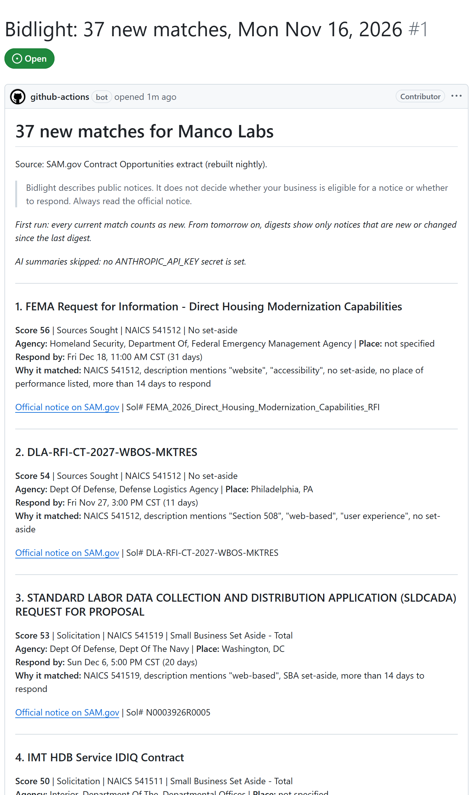

# Bidlight

A daily radar for federal contract opportunities. Bidlight reads every active notice on SAM.gov each morning, keeps the ones that fit a small business's profile, scores them with plain rules, and posts a short digest as a GitHub issue, so GitHub emails it to you.

[Manco Labs](https://mancolabs.dev) is the first user. The repo is a template: fork it, describe your business in two files, and you get your own daily digest.



## What it does

1. **Downloads** SAM.gov's nightly Contract Opportunities file (about 200 MB, about 70,000 active notices). It streams the file instead of loading it whole, so a run needs about 25 MB of memory.
2. **Filters** to the notice types, NAICS codes, and keywords in your profile. It skips notices performed outside the US, deadlines less than 5 days away, and years-old notices that are still marked active.
3. **Scores** each match with rules you can read and change (NAICS, keyword hits, set-aside, location, deadline). Every entry says which rules it hit.
4. **Summarizes** the top 10 in plain English with a small, inexpensive Claude model, including a one-line note comparing the notice to your capability statement. A hard daily cost cap applies, and without an API key the digest still goes out without summaries.
5. **Posts** the digest as an issue in your repo. Notices you have already received never repeat. If one changes after it was sent (new version, new deadline), it shows up under "Amended since we sent them". If nothing is new, nothing is posted.

Bidlight describes notices and links to the official page. It never says a business is eligible for a notice or should respond to one.

## Set up your own

1. **Fork** this repo (or click "Use this template").
2. **Edit `profile.yaml`**: your NAICS codes, keywords, words to exclude, preferred set-asides and states, notice types, and the minimum days before a deadline. Every scoring weight is in there too.
3. **Edit `capability.md`**: a short capability statement. The AI fit notes compare each notice to it.
4. **Empty the sent list**: replace `state/sent.json` with `{"version": 1, "sent": {}}` so your first digest starts fresh.
5. **Add secrets** under Settings > Secrets and variables > Actions:
   - `ANTHROPIC_API_KEY` (optional): turns on AI summaries. Get a key at [platform.claude.com](https://platform.claude.com).
   - `ANTHROPIC_WORKSPACE_ID` (only if needed): if your key is not scoped to a workspace, the API asks for a workspace ID. Copy it from the workspace's page in the Claude Console (it starts with `wrkspc_`). A key created inside a workspace does not need this.
   - `SAM_API_KEY` (optional): adds notices posted since the nightly file was built. Request a key from your SAM.gov account page.
6. **Turn on Actions** in your fork (the Actions tab), then run "Daily digest" once by hand with "Run workflow".
7. **Get the emails**: make sure you watch the repo (Watch > All Activity) and that GitHub email notifications are on. Digest issues are created by GitHub Actions, so they reach you like any other new issue.

From then on it runs every day at 12:00 UTC. To change the time, edit the `cron` line in `.github/workflows/daily.yml`.

The first run treats every current match as new and lists them all. After that, each digest holds only what is new or changed.

> If your fork is public, so are its digest issues. They contain only public notice data, but your profile and capability statement are visible too.

## How matching works

A notice is kept only if all of these hold:

- its type is one of `notice_types` (by default: solicitation, combined synopsis/solicitation, presolicitation, sources sought)
- it is performed in the US, or no place is listed
- its deadline is at least `min_days_to_deadline` days away, or it has no deadline and was posted within `max_age_days_without_deadline` days
- its NAICS code is in your list, **or** one of your keywords is in its title
- its title has none of your `exclude_title_words`, unless a keyword is also in the title or two different keywords are in the description

Then it is scored (defaults shown, all set in `profile.yaml`):

| Rule | Points |
|---|---|
| NAICS code in your list | 25 |
| Keyword in the title | 25 each |
| Keyword in the description only | 8 each |
| Keyword points, at most | 40 |
| Preferred set-aside (for example SBA) | 15 |
| No set-aside | 5 |
| Performed in a preferred state | 10 |
| No place of performance listed | 5 |
| More than 14 days to respond, or no deadline | 5 |

Keywords in the description alone never make a match, because words like "website" appear in thousands of notices as boilerplate ("see our website").

**Amendments.** SAM.gov posts each amendment as a new row with a new notice ID, and some agencies post the same notice several times under different NAICS codes. Bidlight groups rows by solicitation number and agency, keeps the newest row that matches, and drops the opportunity if an award or cancellation was posted after it.

## Data sources and their limits

**Contract Opportunities extract** (primary, no key needed)
`https://s3.amazonaws.com/falextracts/Contract%20Opportunities/datagov/ContractOpportunitiesFullCSV.csv`, listed on [SAM.gov Data Services](https://sam.gov/data-services/Contract%20Opportunities/datagov?privacy=Public).

- Rebuilt nightly, around 04:30 UTC. Notices posted later that day appear in the next day's file.
- There is no published data dictionary. Bidlight checks the column names on every run and stops with a clear error if they change.
- The text encoding is mixed: mostly Windows-1252, with some UTF-8 rows. Bidlight decodes each line separately so both come out readable.
- Deadlines use several formats (with a time zone, date only, no time zone, blank). Ones without a time zone are read as US Eastern.
- The file's own link column needs a SAM.gov login, so digests link to the public page at `sam.gov/opp/<notice id>/view` instead.
- Some notices marked active are years old and have no deadline; Bidlight skips those.

**Get Opportunities Public API** (optional, needs `SAM_API_KEY`)
Documented at [open.gsa.gov](https://open.gsa.gov/api/get-opportunities-public-api/).

- A personal key for a non-federal user with no SAM.gov role allows **10 requests a day**; with a role, 1,000. Bidlight makes one request per NAICS code (3 for the default profile) and stops at `sam_api.max_requests_per_run` or at the first "too many requests" reply.
- The API returns a link to each description rather than the text, so notices that only come from the API are matched on title, NAICS, and the other fields.

## AI summaries and cost

Summaries use `claude-haiku-5-5` (set in `profile.yaml`). Each summary sends the notice's title, key fields, the first 6,000 characters of its description, and your capability statement, and gets back two or three sentences plus a one-line fit note. That is about 3,000 tokens in and 250 out, roughly **half a cent a day** for 10 summaries.

- `ai.daily_cost_cap_usd` (default $0.05) is a hard stop. Before each call Bidlight estimates the most that call could cost; if it would pass the cap, the remaining matches go out without summaries.
- The deadline and set-aside next to each summary come straight from SAM.gov's data, not from the model.
- Any summary that claims eligibility or advises bidding is dropped, and the plain entry is kept.

## Run it locally

```bash
python -m venv .venv
.venv/bin/pip install -r requirements-dev.txt     # Windows: .venv\Scripts\pip
.venv/bin/python -m pytest
.venv/bin/python -m bidlight --dry-run            # writes digest.md, posts nothing, saves nothing
```

Use `--file path/to/ContractOpportunitiesFullCSV.csv` to work from a downloaded copy.

The tests run on 59 real rows cut from the 2026-11-16 extract (`tests/fixtures/`), covering parsing, filtering, scoring, amendment grouping, and duplicate tracking.

## Why Python

The standard library's `csv` module streams a 200 MB file row by row with no extra packages, the official `anthropic` SDK covers the summaries, and there is no build step, so the daily job is just "install, run". Someone forking the repo edits YAML and Markdown, not code.

## Future ideas

Not in this version:

- State and local procurement portals
- Award history research with [USAspending](https://www.usaspending.gov) (who won similar work, and for how much)
- A web dashboard
- Multiple users or profiles in one repo
- Sites whose terms prohibit automated access (for example Upwork) are out of scope for good.

## Credits

Built with Claude Code. I designed, directed, reviewed, and tested it.

Data comes from SAM.gov, a U.S. government website. Bidlight is not affiliated with or endorsed by GSA or SAM.gov.

MIT license.
